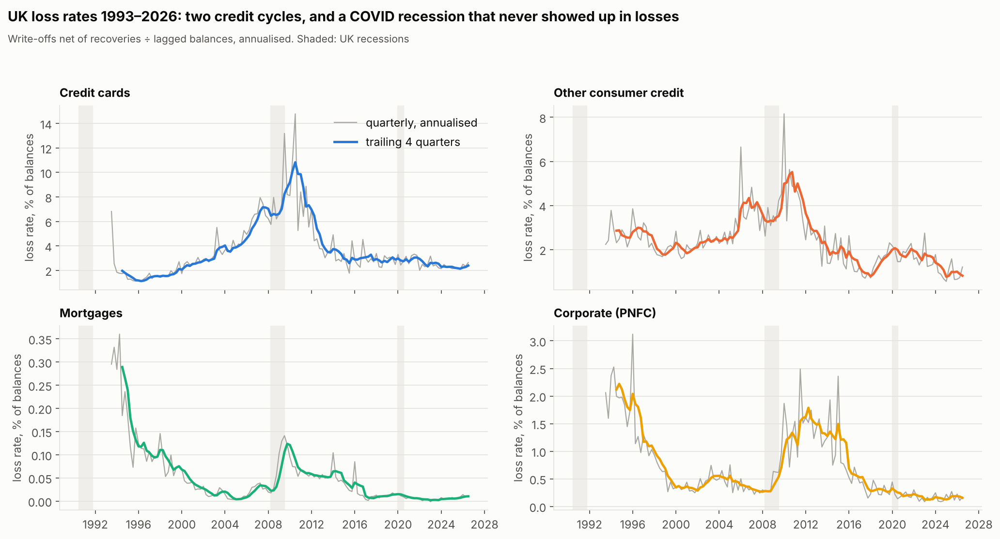
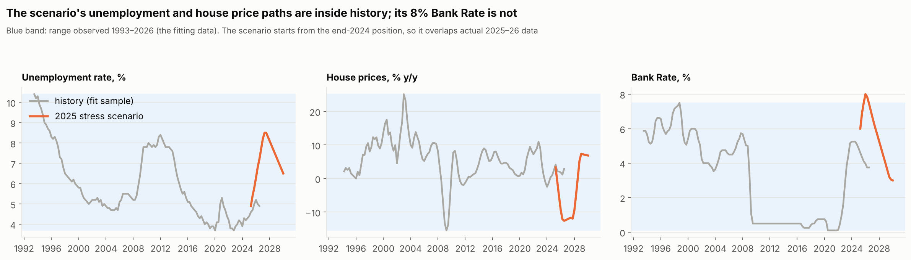

# UK Credit Stress Testing Engine

[](https://github.com/TilakHeble/uk-credit-stress-engine/actions/workflows/ci.yml)

**If the UK enters the Bank of England's 2025 stress scenario, how much would UK lenders lose on credit cards, personal loans, mortgages and corporate lending, and how sure can we be?**

The scenario: UK GDP −5%, unemployment 8.5%, house prices −28%, Bank Rate 8%.

This project builds the macro "satellite" models that bank credit-risk teams use for Bank of England stress tests and IFRS 9 provisioning. These models are regressions linking portfolio loss rates to the economy. The project then projects losses under the official 2025 scenario and documents the models to the standard of the PRA's model risk principles (SS1/23).

> Status: **Stages 1–5 of 7 complete:** data pipeline, exploratory analysis, OLS from scratch, model selection, diagnostics, regularisation and panel models.

## Plan

| Stage | Notebook | Content | Status |
|---|---|---|---|
| 1 | [`01_eda`](notebooks/01_eda.ipynb) | Loss-rate construction, data breaks, credit cycles, lead–lag, stationarity, scenario vs history | ✅ |
| 2 | [`02_ols_from_scratch`](notebooks/02_ols_from_scratch.ipynb) | Normal equation (QR), gradient descent, robust errors, checked against statsmodels | ✅ |
| 3 | [`03_model_development`](notebooks/03_model_development.ipynb) | Candidate drivers and lags, economic sign rules, exhaustive search, AIC/BIC, VIF | ✅ |
| 4 | [`04_diagnostics`](notebooks/04_diagnostics.ipynb) | Residual tests, influential quarters, HAC errors, WLS, transforms, robust regression, structural breaks | ✅ |
| 5 | [`05_regularisation_panel`](notebooks/05_regularisation_panel.ipynb) | Ridge / Lasso / Elastic Net with time-series CV; pooled panel with fixed effects | ✅ |
| 6 | [`06_validation`](notebooks/06_validation.ipynb) | Out-of-time backtests (2008, 2020), bootstrap, quantile regression, sensitivity, challenger model | ✅ |
| 7 | [`07_scenario_projection`](notebooks/07_scenario_projection.ipynb) | Loss paths under the 2025 scenario with prediction intervals, £bn losses, reverse stress test | ✅ |

## Data

All public, all real, committed under the [Open Government Licence v3.0](https://www.nationalarchives.gov.uk/doc/open-government-licence/version/3/):

| Source | Series |
|---|---|
| Bank of England (Bankstats C2.1, database) | Write-offs by portfolio (RPQTFHE cards, RPQTFHF other consumer, RPQTFHD mortgages, RPQTFHB corporate); amounts outstanding (RPQB74D, RPQB75D, RPQB73D, RPQB69D); Bank Rate (IUQABEDR); 2-year fixed mortgage rate (IUMBV34) |
| ONS | Unemployment rate (MGSX), real GDP (ABMI), CPI inflation (D7G7) |
| HM Land Registry | UK House Price Index |
| Bank of England | [2025 Bank Capital Stress Test variable paths](https://www.bankofengland.co.uk/stress-testing/uk-banks-building-societies/bank-capital-stress-test) |

**Loss rate** = 4 × write-offs in the quarter ÷ balance at the end of the previous quarter (the Bank of England's recommended comparison). Modelling target: the trailing four-quarter rate.

## Stage 1 findings



| # | Finding | Decision |
|---|---|---|
| 1 | Balances jump at reporting-population changes (mortgages +61% in 1997 Q2, +34% in 2007 Q4), but the loss *rate* barely moves across most breaks | No splicing; test step dummies at the card breaks (2010 Q1, 2013 Q1) |
| 2 | Write-offs are lumpy: 26 quarters with robust z > 4, e.g. block write-offs in cards in 2003 Q1 and 2009 Q2 | Model the trailing 4-quarter loss rate; autocorrelation-robust errors for the overlap |
| 3 | Card losses were already ~6% in 2004–06 with unemployment at 5%: the UK personal-insolvency boom, a credit cycle the macro data cannot see | Test a lagged credit-growth driver; report 2004–07 as a known limitation |
| 4 | Card losses peaked at 10.8% (trailing) in 2009–11; mortgages at only ~0.12% despite large house price falls | Cards and other consumer credit are the core models; the mortgage model is lower confidence |
| 5 | COVID: GDP −22% y/y, yet loss rates *fell* (furlough, payment holidays) | Treat 2020–21 as a policy-intervention regime |
| 6 | **The change in unemployment leads card losses by ~4 quarters** (r = +0.71); the unemployment *level* barely correlates with card losses | Unemployment enters cards as a lagged change; levels for corporate and mortgages (r = 0.94 / 0.86) |
| 7 | Loss rates and the unemployment level are non-stationary or borderline (ADF/KPSS); their changes are stationary | Compare a levels model, with an Engle–Granger cointegration check, against a differences model |
| 8 | **The scenario's 8% Bank Rate lies outside the 1993–2026 fitting data** (max 7.5%); unemployment and house prices are inside | Interest-rate effects are an extrapolation: flagged for sensitivity analysis and the model limitations section |
| 9 | My ONS / Land Registry history matches the Bank of England's own scenario history (correlation ≥ 0.995) | Scenario paths can be joined to the fitting data without rebasing errors |



## Run it

```bash
make install   # pip install -e ".[dev,dashboard]"
make panel     # build data/processed/quarterly_panel.parquet from data/raw (Pandera contract enforced)
make test      # 11 tests: readers, panel contract, OLS engine vs statsmodels
make notebooks
```

## Repository layout

```
data/raw/            Bank of England, ONS and Land Registry downloads (committed, OGL v3)
src/ukstress/
  ingest/            readers, panel build, Pandera data contract
  models/            ols_scratch.py: OLS / gradient descent / influence from first principles
  viz.py             shared chart style
notebooks/           one notebook per stage
reports/figures/     charts used in this README
tests/
```
