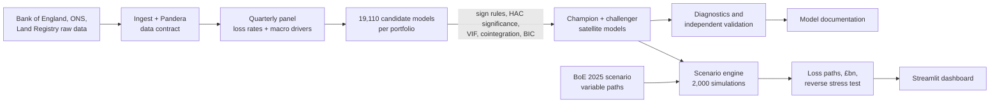
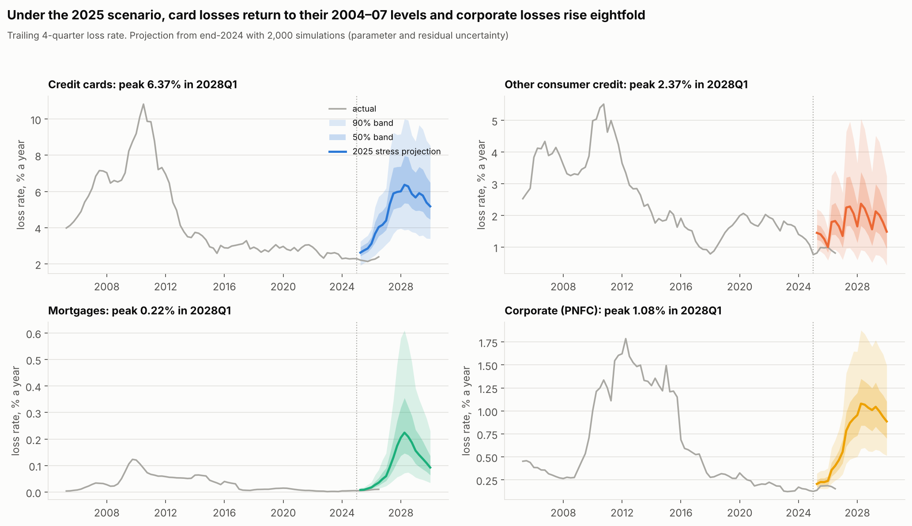
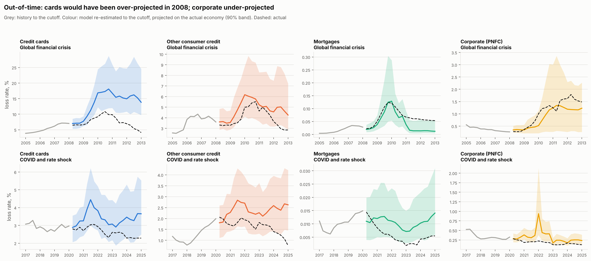

# UK Credit Stress Testing Engine

[](https://github.com/TilakHeble/uk-credit-stress-engine/actions/workflows/ci.yml)

**If the UK enters the Bank of England's 2025 stress scenario, how much would UK lenders lose on credit cards, personal loans, mortgages and corporate lending, and how sure can we be?**

The scenario: UK GDP −5%, unemployment 8.5%, house prices −28%, Bank Rate 8%.

This project builds the macro **satellite models** that bank credit-risk teams use for Bank of England stress tests and IFRS 9 scenarios. These are regressions linking portfolio loss rates to the economy. It projects losses under the official 2025 scenario, validates the models as an independent reviewer would, and documents them to the structure of the PRA's model risk principles (SS1/23).

**Start here**
- 📄 [Executive summary](docs/executive_summary.md): the answer, for a risk committee
- 📘 [Model development document](docs/model_development_document.md): data, method, champion models, limitations
- ✅ [Independent validation report](docs/validation_report.md): backtests, benchmark, findings, ratings
- 📊 Interactive dashboard: `make dashboard` (scenario builder with severity and driver sliders)
- 📓 Notebooks [01](notebooks/01_eda.ipynb) · [02](notebooks/02_ols_from_scratch.ipynb) · [03](notebooks/03_model_development.ipynb) · [04](notebooks/04_diagnostics.ipynb) · [05](notebooks/05_regularisation_panel.ipynb) · [06](notebooks/06_validation.ipynb) · [07](notebooks/07_scenario_projection.ipynb)



## Headline result

**Five-year write-offs of about £44 billion across the four portfolios, £32 billion more than end-2024 loss rates would produce; £35–49 billion across modelling choices.**

| Portfolio | Loss rate end-2024 | Peak (2028 Q1) | Five-year cumulative (90% interval) | Five-year losses | Validation |
|---|---|---|---|---|---|
| Credit cards | 2.3% | 6.4% | 24.4% (17.5–34.8%) | £12.9bn | 🟡 Amber, conservative |
| Other consumer credit | 0.8% | 2.4% | 7.0% (3.0–13.7%) | £5.3bn | 🟡 Amber, weak |
| Mortgages | 0.01% | 0.22% | 0.53% (0.24–1.22%) | £7.8bn | 🟡 Amber |
| Corporate (PNFC) | 0.13% | 1.08% | 3.6% (2.3–5.6%) | £18.2bn | 🟢 Green |



**Benchmarked against the Bank of England's own 2025 results** (December 2025 FSR, Table 5.C). Its five-year *impairment* rates are 23.3% for consumer credit and 1.0% for mortgages; this project's *write-off* rates are 14.2% and 0.53%. Impairments should be higher, because IFRS 9 books lifetime losses before debts are written off. The ratio is a consistent 0.5–0.6 across portfolios, which is the evidence of sound relative calibration.

## What makes this more than a regression exercise

1. **Bank-style model selection, not best fit.** 19,110 candidates per portfolio are filtered by economic sign rules, Newey–West significance, VIF and cointegration *before* fit is considered. A significant but wrong-signed Bank Rate coefficient (notebook 02) shows why. Every sign-correct static model turned out to be a spurious regression.
2. **The selection is checked independently.** A sign-constrained Lasso, free to choose among 49 macro features, picks the same card drivers as the champion. Unconstrained Lasso uses 13 wrong-signed features out of 17 and **understates the card stress peak by half**.
3. **Honest validation, including what does not work:**
   - Re-estimated in 2007, the card model would have *over*-projected the crisis.
   - It loses to a no-change forecast in benign periods.
   - Since end-2024 the consumer models have over-predicted, the same judgement the Bank of England made when it cut its consumer loss assumptions.
4. **Model risk reported as ranges.** Jump-off adjustment, challengers, a pooled consumer panel (slope homogeneity tested), transform choice and a credit-quality overlay.
5. **Reverse stress test.** Mortgages pass their 2008–12 peak loss rate at 80% of the scenario's severity, because Bank Rate *rises* (it was cut in 2009). Cards need a recession twice as severe.
6. **Every number is traceable to linear algebra.** OLS, Newey–West, F-tests, AIC/BIC, leverage and Cook's distance are implemented from first principles and unit-tested against statsmodels to machine precision.

## Linear regression techniques covered

| Area | Techniques | Where |
|---|---|---|
| Foundations | Normal equation via QR, gradient descent and learning rates, FWL theorem, confidence vs prediction intervals | 02 |
| Inference | t and F tests, nested-model F, classical / White / Newey–West errors, Driscoll–Kraay panel errors | 02, 03, 05 |
| Specification | Lags, logit/log/Box-Cox transforms, dummies, hinge (asymmetric) terms, polynomials, interactions, exhaustive search, AIC/BIC, VIF | 03, 04 |
| Diagnostics | Breusch–Pagan, White, Jarque–Bera, Durbin–Watson vs Breusch–Godfrey, Ljung–Box, RESET, ADF/KPSS, Engle–Granger cointegration | 01, 03, 04 |
| Influence and robustness | Leverage, Cook's distance, DFBETAS, WLS (feasible GLS), Huber M-estimation | 02, 04 |
| Stability | Chow tests, CUSUM, recursive estimates, step dummies | 04 |
| Regularisation | Ridge, Lasso, Elastic Net, sign-constrained Lasso, Lasso paths, time-series cross-validation | 05 |
| Panel | Pooled vs fixed effects, slope-homogeneity F-test, clustered and Driscoll–Kraay errors | 05 |
| Uncertainty and validation | Block bootstrap, quantile regression, simulation with parameter and residual uncertainty, out-of-time and rolling-origin backtests | 06, 07 |

## Data

All public and real, committed under the [Open Government Licence v3.0](https://www.nationalarchives.gov.uk/doc/open-government-licence/version/3/):

| Source | Series |
|---|---|
| Bank of England (Bankstats C2.1, database) | Write-offs by portfolio (RPQTFHE cards, RPQTFHF other consumer, RPQTFHD mortgages, RPQTFHB corporate); amounts outstanding (RPQB74D, RPQB75D, RPQB73D, RPQB69D); Bank Rate (IUQABEDR) |
| ONS | Unemployment (MGSX), real GDP (ABMI), CPI inflation (D7G7) |
| HM Land Registry | UK House Price Index |
| Bank of England | [2025 Bank Capital Stress Test variable paths](https://www.bankofengland.co.uk/stress-testing/uk-banks-building-societies/bank-capital-stress-test); [FSR December 2025](https://www.bankofengland.co.uk/financial-stability-report/2025/december-2025) (benchmark) |

**Loss rate** = write-offs ÷ previous quarter-end balance (the Bank of England's recommended comparison); modelling target = trailing four-quarter rate, logit scale.

## Stage-by-stage findings

| Stage | Notebook | Key finding |
|---|---|---|
| 1 | [EDA](notebooks/01_eda.ipynb) | The change in unemployment leads card losses by ~4 quarters (r = 0.71); COVID cut GDP 22% yet losses *fell*; the scenario's 8% Bank Rate is outside the fitting data |
| 2 | [OLS from scratch](notebooks/02_ols_from_scratch.ipynb) | Residual autocorrelation of 0.92 from the overlapping target: Newey–West errors cut t-statistics ~40%. A significant coefficient can have the wrong sign |
| 3 | [Model development](notebooks/03_model_development.ipynb) | 32 / 4 / 334 / 49 models pass every rule (cards / other consumer / mortgages / corporate); all champions are dynamic |
| 4 | [Diagnostics](notebooks/04_diagnostics.ipynb) | Residuals stationary once the overlap is accounted for; other consumer is fragile; credit growth three years earlier predicts card losses |
| 5 | [Regularisation & panel](notebooks/05_regularisation_panel.ipynb) | Sign-constrained Lasso confirms the champion; cards and other consumer share slopes (p = 0.39) |
| 6 | [Validation](notebooks/06_validation.ipynb) | Corporate skill +0.40 vs no-change; card model conservative; consumer models over-predict 2025–26 |
| 7 | [Projection](notebooks/07_scenario_projection.ipynb) | £44bn five-year losses; BoE benchmark ratio 0.5–0.6; mortgages exceed their crisis peak in the scenario |



## Run it

```bash
make install     # pip install -e ".[dev,dashboard]"
make panel       # build data/processed/ from data/raw (Pandera contract enforced)
make test        # 24 tests: readers, data contract, OLS engine vs statsmodels, models, scenarios, dashboard
make notebooks   # re-execute notebooks 01–07 (notebook 03 runs the full search, ~4 minutes)
make dashboard   # streamlit run dashboards/app.py
```

To deploy the dashboard on Streamlit Community Cloud, point it at `dashboards/app.py`; dependencies are in `dashboards/requirements.txt`.

## Repository layout

```
data/raw/                 Bank of England, ONS and Land Registry downloads (committed, OGL v3)
src/ukstress/
  ingest/                 readers, panel build, Pandera data contract
  features/build.py       target transform, lagged drivers, scenario paths and severity scaling
  models/satellite.py     specification, sign-constrained search, HAC fitting, simulated projection
  models/ols_scratch.py   OLS, Newey–West, F-tests, AIC/BIC, influence from first principles
  validation/backtest.py  out-of-time and rolling-origin backtests, BoE benchmark
  scenarios/engine.py     scenario runs, jump-off adjustment, £ losses (shared with the dashboard)
models/                   champions, challengers, search results, scenario outputs
notebooks/                one notebook per stage (01–07)
docs/                     executive summary, model development document, validation report
dashboards/app.py         Streamlit scenario builder
reports/figures/          charts used in the docs
tests/
```
